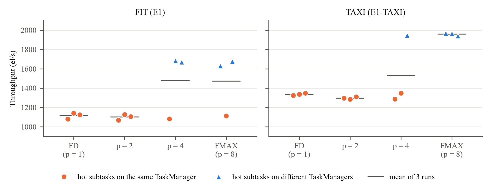
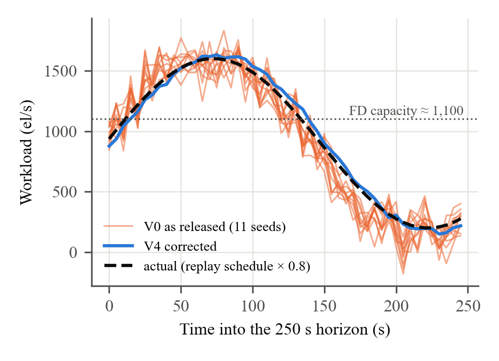
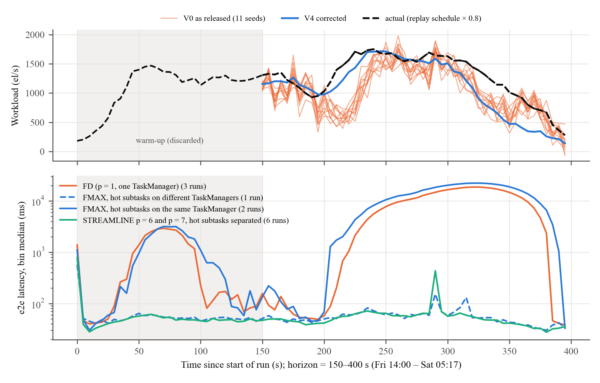

::: front
title: Reproducing STREAMLINE: workload-aware auto-tuning of Apache Flink pipelines on a small Kubernetes cluster
authors: Hamza Alqaruoti^a,*; Mohammad Alqaryouti^a; Noura Alrahbi^a; Sulaiman Shawabkeh^a
affiliation: a | The British University in Dubai, Dubai, United Arab Emirates
corresponding: * Corresponding author. E-mail address: [[email]]
note: AI508 Big Data Technologies and Applications, Assignment 2 (reproduction report). Module coordinator: Dr Ghada Alsuhli. Prepared in the format of Future Generation Computer Systems (Elsevier); not a published article.
keywords: Stream processing; Auto-tuning; Apache Flink; Reproducibility; Workload prediction; Kubernetes
:::

::: highlights
- STREAMLINE's ETL experiments reproduced on Flink, Kafka and Kubernetes
- Flink's default configuration lost 32–33% throughput to maximum parallelism
- A single-key benchmark made throughput depend on random slot placement
- The paper's cost savings cannot be expressed through Beam's job-wide parallelism
- Fixing the forecaster cut STREAMLINE's TAXI cost by 19% at equal latency
:::

# Abstract

STREAMLINE auto-tunes Apache Flink pipelines: a Transformer forecasts the workload, a neural surrogate and a polynomial capacity model predict operator behaviour, and NSGA-II chooses each operator's parallelism and buffer size. On a 30-node cluster, the original study reports for its ETL pipeline a 76% latency reduction against Flink's default configuration (FD) on the FIT dataset, and cost reductions of 51% and 67% against FD and maximum parallelism (FMAX) on the TAXI dataset. We reproduced these experiments on both datasets with the authors' unmodified benchmark and tuner, on a Kubernetes cluster with four one-core Flink TaskManagers, Kafka and MongoDB. We built the parts the authors did not release (Flink integration, measurement harness, training data) and measured throughput, true end-to-end latency, CPU use and emulated cost, with three runs per configuration. The direction of the throughput and latency findings was reproduced. At saturation FD processed 32–33% less than FMAX on both datasets. When workload peaks exceeded FD's capacity, STREAMLINE's configurations cut median latency by about 99% on both datasets; on the real TAXI arrival pattern they stayed near 54 ms while FD queued for up to 20 s. The cost savings were not reproduced, because Apache Beam's Flink runner exposes only job-wide parallelism. The benchmark routes every record to a single key, so FMAX matched STREAMLINE only when Flink happened to place two busy subtasks apart. Fixing two defects in STREAMLINE's released forecaster changed its decisions and saved one TaskManager on TAXI at the same latency.

# 1. Introduction

Stream processing systems such as Apache Flink [1] run continuously over data whose rate changes by the hour. A configuration fixed at deployment time is either too small for the peaks, so records queue and latency grows, or too large for the troughs, so paid resources sit idle. Choosing operator parallelism, buffer sizes and operator placement by hand does not keep up with such changes, and this is the motivation for runtime auto-tuners [2,3]. Reactive controllers such as Dhalion [4] and DS2 [5] adjust parallelism from observed metrics, predictive ones such as Demeter [6] act on a workload forecast, and Siachamis et al. compared several of them experimentally on the same engine [7]. Our earlier systematic review [8] covered 51 studies on adaptive runtime management in stream processing. Among them, STREAMLINE [9] stood out because its code [10] and benchmark [11] are public, its datasets are public, and it combines workload prediction with configuration tuning and scheduling.

STREAMLINE was published in *Internet of Things* in 2025 [9]. It claims improvements of up to 4× in throughput, 10× in end-to-end latency and 9× in CPU utilisation, and cost reductions of up to 10×, against three baselines: Flink's default configuration (FD), maximum parallelism (FMAX) and the ContTune tuner (CT) [12].

This reproduction had three objectives:

1. **O1. Decision layer.** Run the released STREAMLINE code, check that it reproduces the decisions documented in its README, and audit its prediction path.
2. **O2. Big Data experiment.** Reproduce the ETL experiment of the original §5.1.1 (FD vs FMAX vs STREAMLINE on the FIT and TAXI datasets) on a real Flink, Kafka and Kubernetes stack, and compare throughput, end-to-end latency, CPU utilisation and cost with the paper as relative outcomes.
3. **O3. Extension.** Test whether the defects we found in the released forecaster change STREAMLINE's decisions, and the measured outcome, inside a running cluster.

The Yahoo Streaming Benchmark experiments, the ContTune baseline, the multi-pipeline ensembles and the seamless reconfiguration mechanism (Algorithm 5 of [9]) are out of scope. None of these is in the released code, and rebuilding them would have meant writing new systems rather than reproducing a published one. The STATS, PRED and TRAIN pipelines were left out for time. Section 2 summarises the original study, Section 3 describes our environment and method, Section 4 reports results against the paper's, Section 5 discusses the differences, and Section 6 concludes.

# 2. Original Study

## 2.1. Method

STREAMLINE treats a pipeline as a directed graph of operators. For each operator *i* it chooses two configuration parameters, the parallelism *x_i* and the network-buffer segment size *s_i* (16, 32 or 64 KiB), and a node on which to run it. It has four components:

- **Workload predictor.** A Transformer encoder [13] (4 layers, 4 heads, d_model 128) receives the last 100 observations of the source workload and outputs the next 30 (paper) or 50 (released examples) steps. Downstream operator workloads are derived from the source forecast with each operator's input/output ratio.
- **Performance models.** A neural network (two hidden layers of 256 and 128 units) predicts each operator's throughput, latency and CPU use from its input rate, parallelism, segment size and operator type. A polynomial regression of capacity against parallelism gives the throughput an operator can sustain.
- **Configuration optimiser.** NSGA-II [14] (population 20, 20 generations) searches the parallelism and segment-size space for each operator. It trades off throughput, latency and CPU with the weights β = [0.5, 0.25, 0.25] and picks the configuration that can carry the forecast peak.
- **Scheduler and update.** A resource-aware scheduler packs operators onto as few nodes as possible. A savepoint-based "seamless" update then applies the new configuration, keeping the old job running until the new one has caught up.

The models are trained offline on profiled runs. Online, STREAMLINE is triggered at deployment and again halfway through each experiment.

## 2.2. Experimental setup

The authors ran Flink 1.19.1 and Kafka [15] 3.7.0 on a 30-node Kubernetes cluster on Grid'5000 (Gros cluster, Nancy). Nodes were virtualised in three types: type 1 with 4 cores, 8 GB and $0.192/h; type 2 with 8 cores, 16 GB and $0.384/h; and type 3 with 16 cores, 24 GB and $0.768/h. Prices are those of comparable AWS instances. Four RIoTBench pipelines [16] were evaluated, ETL, STATS, PRED and TRAIN, plus YSB. Two datasets were replayed through Kafka:

- **FIT:** MHEALTH body-sensor data [17], a steady workload of about 7,000 elements per second (el/s).
- **TAXI:** New York City taxi trips from 2013 [18], a fluctuating workload of 1,000 to 10,000 el/s.

Throughput was read from the Flink REST API every 5 s, end-to-end latency from Flink latency markers, CPU from per-thread CPU time, and cost from the node prices. Each experiment was repeated three times and averaged.

## 2.3. Findings relevant to this reproduction

Table 1 lists the paper's statements for the ETL pipeline, which are the targets of our comparison.

Table: Table 1. The original study's ETL results [9, §5.1.1] used as reproduction targets.

| Dataset | Statement in the original study |
|---|---|
| Both | STREAMLINE and FMAX reach the highest throughput, within 1% of each other |
| FIT | FD throughput 34% lower than STREAMLINE |
| FIT | STREAMLINE end-to-end latency 76% lower than FD |
| FIT | STREAMLINE cost 63% lower on average than the baselines; CPU utilisation 211% higher |
| TAXI | FD handles low load but struggles at higher rates: 14% lower average throughput |
| TAXI | Average latency of FD and FMAX differs by less than 4%; STREAMLINE 46% lower than CT |
| TAXI | STREAMLINE cost 51% lower than FD and 67% lower than FMAX, on a single type-2 node |
| Both | FD has better CPU utilisation than FMAX; FMAX the poorest |

# 3. Reproduction Methodology

## 3.1. Code and integrity rules

We used two public repositories: STREAMLINE's decision layer [10] (commit d65baec, GPLv3) and the authors' Apache Beam [19] benchmark [11] (commit 57524e2). The benchmark contains the RIoTBench pipelines, the data converter and a Kafka producer. We did not edit either repository. Every fix or alternative behaviour lives in our own scripts, and every difference from the authors' setup is recorded with its reason in a modification log in our repository. The paper's results and ours are kept in separate columns throughout this report.

## 3.2. Environment

Table: Table 2. Computing environment.

| Item | Original study | This reproduction |
|---|---|---|
| Hardware | 30 virtual nodes on Grid'5000 | One laptop: Intel Core Ultra 7 255HX (20 threads), 31 GB RAM |
| Orchestration | Kubernetes, Flink Kubernetes Operator | Kubernetes via k3d (k3s v1.35) in Docker Desktop (WSL2) |
| Stream processor | Flink 1.19.1 | Flink 1.18.1, the version the benchmark pins (Beam 2.57 FlinkRunner) |
| Workers | Type 1–3 nodes, slots = cores | 4 TaskManagers × (1 CPU, 2 GiB, 2 slots): type 1 scaled by ¼, as in the authors' Helm chart |
| Messaging, storage | Kafka 3.7.0 (3 brokers), MongoDB | Kafka 3.7.0 (1 broker, same 1-partition topics), MongoDB 7 |
| Tuner | Python, PyTorch, CUDA | Python 3.8, PyTorch 2.4.1 (CPU), pymoo 0.6.1.2 [20] |

Our cluster has about a tenth of the paper's compute, so we compare relative outcomes (ratios between configurations), not absolute rates. Emulated cost counts the TaskManagers that host at least one task at the paper's type-1 price of $0.192/h.

## 3.3. Data and preprocessing

**FIT.** We downloaded UCI MHEALTH [17] (10 subjects, 75.6 MB) and converted it with the authors' `senMlConverter` Docker image into 1.2 million SenML records. **TAXI.** The authors' source, the University of Illinois Data Bank [18], refused our downloads, so we used the Internet Archive mirror of the same 2013 release (checksums verified). Two differences had to be handled. First, the mirror stores taxi and licence identifiers as MD5 hashes, which we mapped to integers by first appearance. Second, its rows are not in time order, so we sorted them by pickup time. As the converter's README prescribes, we restricted the data to the week of 14–21 January 2013: 3,466,804 trips. A check with the authors' own parser and range filter read 300,000 converted records without an error.

**Replay.** Records are replayed with the authors' unmodified Kafka producer, which sends each line once its scheduled delay has passed. We found that its thread striding skips every fifth line, so the effective rate is 0.8 times the rate in the file. All rates in this report are effective (measured) rates. We built three kinds of replay schedule, changing only the delay column and never the records:

- constant rates for capacity measurements;
- stepped and sinusoidal loads for STREAMLINE's profiling and FIT evaluation;
- the real TAXI arrival pattern, compressed in time by a factor of 220 (the converter's `SCALING` = 1/220).

## 3.4. Measurement harness

The authors did not release their measurement setup, so we wrote one in Python. For each run, it does the following:

1. recreate the Kafka topics and restart the TaskManager pods, because Beam's Kafka reader leaks a polling thread when a job is cancelled;
2. submit the unmodified benchmark jar with the job-wide parallelism under test;
3. start the producer;
4. every 5 s, record Flink REST metrics per vertex and per subtask, pod CPU, the TaskManager hosting every subtask, and the CPU load of the host itself.

The first 150 s of each run are discarded as JIT warm-up. Runs were interleaved across configurations and repeated three times.

**Latency.** The paper used Flink latency markers [21]. We found that they mislead in this benchmark for three reasons. Their histograms are long-lived, so warm-up values persist. Each marker goes to one random downstream subtask, so at parallelism *p* a subtask's 60-marker window spans about 60·*p* seconds. And markers start at the source operator, so they miss time spent waiting in Kafka, which dominates under overload. We therefore measured **true end-to-end latency**, which Karimov et al. [22] call event-time latency because it includes the time a record waits before the system reads it: the topics use broker LogAppendTime, and the *i*-th output record's broker timestamp minus the *i*-th input record's gives each record's latency. An order check on sampled records confirmed the one-to-one matching in every run (match fraction 1.0).

**Validity controls.** The cluster shares a laptop with other processes, so we logged host load per sample and checked the Windows power log per run. Runs that overlapped CPU-heavy host jobs, battery power or Modern Standby were excluded and re-measured. Battery power alone raised CPU per record by 25–40%. Eighteen runs were re-measured for these reasons, and the excluded runs are kept in separate folders.

## 3.5. STREAMLINE in the loop

The released code contains the decision layer only, so we connected it to the cluster ourselves:

- **Operators.** Beam fuses the ETL job into two Flink vertices, which we model as two STREAMLINE operators: v_0, the source chain, and v_1, Interpolate through the sinks.
- **Training data.** Twelve profiling runs (parallelism 1, 2, 4, 8 × segment size 16, 32, 64 KiB) under a stepped load gave about 1,000 training rows in STREAMLINE's input format. The authors' collector is unpublished, so the column mapping is ours and documented.
- **Workload history.** The forecaster was trained on 30 minutes of measured source workload.
- **Hyperparameters.** We used the released example's settings (input 100, output 50, 200 epochs) rather than the paper's Table 2 (output 30, 500 epochs), because the decision code expects the example's horizon.
- **Mapping to Flink.** Beam's FlinkRunner accepts only one parallelism for the whole job and cannot pin operators to nodes. A per-operator plan therefore became job parallelism = max over operators, TaskManagers = ⌈p/2⌉, and the chosen segment size as a TaskManager setting. Each configuration was deployed as a fresh job instead of through the seamless update.
- **Variants (O3).** V0 is the code as released. V4 fixes two forecaster defects: dropout left active at inference, and the input window fed to the network without the scaling used in training. Both load the same trained models and were run with 11 random seeds.

## 3.6. Experiments

Table: Table 3. Experiments.

| ID | Question | Design |
|---|---|---|
| E0 | Does the released decision layer work, and is it correct? | README examples; code audit; 2³ factorial correction study (88 runs) |
| E1 | Capacity of FD vs FMAX | p = 1, 2, 4, 8; constant overload; 360 s; 3 reps; FIT and TAXI |
| L1 | Does parallelism buy latency below capacity? | FD, p = 4, FMAX at ~780 el/s; true e2e latency; 3 reps |
| E3 | STREAMLINE V0 and V4 vs FD and FMAX (FIT) | Sinusoidal workload peaking at 1,599 el/s; decision on a 250 s forecast horizon; 3 reps per configuration |
| E3-T | Same on TAXI's real arrival pattern | Mon–Fri 14:00 history; horizon Fri 14:00 – Sat 05:17 (real time), effective 279–1,752 el/s; 3 reps |

# 4. Results and Comparison

## 4.1. Decision layer (E0)

The two README examples ran and reproduced the documented decisions. The audit found three defects in the prediction path:

1. In the two-pipeline example, the second pipeline's workload update is written under the wrong key (`v_0` instead of `v_5`).
2. The forecaster is left in training mode, so dropout is active at inference and forecasts change from call to call.
3. The input window is not scaled the way the training data was.

A fourth issue, a checkpoint alias, returns the last epoch rather than the best, but had no measurable effect.

In a 2³ factorial study on the authors' example workloads, fixing all three defects cut the mean forecast error from 317.9 to 23.4 el/s (−93%) and removed negative forecasts, which appeared in 11.5% of steps before the fix. The fixes interact, so their effects do not simply add. The released code is runnable, but its forecasts are noisier than the paper implies.

## 4.2. Capacity: FD vs FMAX (E1)

Table: Table 4. Saturated throughput, mean ± SD over 3 runs (measured in this reproduction).

| Configuration | TMs | FIT throughput (el/s) | TAXI throughput (el/s) | CPU util. FIT / TAXI | Cost ($/h) |
|---|---|---|---|---|---|
| FD (p = 1) | 1 | 1,115 ± 32 | 1,337 ± 12 | 1.06 / 1.10 | 0.192 |
| p = 2 | 1 | 1,100 ± 30 | 1,296 ± 14 | 1.06 / 1.12 | 0.192 |
| p = 4 | 2 | 1,478 ± 344 | 1,528 ± 365 | 0.71 / 0.64 | 0.384 |
| FMAX (p = 8) | 4 | 1,473 ± 314 | 1,959 ± 16 | 0.36 / 0.40 | 0.768 |

Every run was saturated: the offered load was 2,620–2,742 el/s and the bottleneck subtask was 100% busy in all 24 runs. FD processed 24% (FIT) and 32% (TAXI) less than FMAX. The large standard deviations at p = 4 and on FIT at p = 8 do not come from measurement noise. Fig. 1 shows their source.

{full}

The ETL job keys every record with one constant key (`WithKeys.of("")`) before its Interpolate step, and the input topic has one partition. So, whatever the parallelism, one source subtask and one Interpolate subtask do all the work. Extra parallelism helps only if Flink's slot assignment puts these two on different TaskManagers, and that assignment varies from run to run. Key skew is a known limit on stream parallelism [23]; here it is total, because there is only one key.

- With the two subtasks separated, throughput was 1,630–1,684 el/s on FIT and 1,940–1,969 el/s on TAXI.
- With them co-located, every configuration fell back to FD's level.
- Counting separated runs only, FD is 33% (FIT) and 32% (TAXI) below FMAX, close to the paper's 34% on FIT.
- In one FIT run FMAX was co-located and reached 1,111 el/s, the same as FD at four times the cost. Over all 18 runs at p = 8 in this project, 3 were co-located.

## 4.3. Latency below capacity (L1)

At about 780 el/s, below every configuration's capacity, true end-to-end latency was the same for FD, p = 4 and FMAX in 8 of 9 runs: p50 33–39 ms, p95 98–115 ms, p99 130–160 ms. FD therefore gives the same latency at a quarter of FMAX's cost. One FD run had a 30 s throughput stall of unknown cause; with only 20% headroom, the backlog took about 90 s to clear. Latency markers, measured in separate runs, reported multi-second p95 values at p = 4 and 8. Those values are an artefact of how markers are routed (Section 3.4).

## 4.4. STREAMLINE in the loop on FIT (E3)

The FIT evaluation workload is a sinusoid between 201 and 1,599 el/s, so its peaks exceed FD's capacity (about 1,100 el/s). Table 5 and Fig. 2 summarise forecasts, decisions and outcomes.

Table: Table 5. E3 on FIT (measured). Baselines: FD p50 17,228 / 21,839 / 16,804 ms, lower bounds because records still queued at the end of a run were not counted; FMAX p50 62 / 63 / 21,074 ms (the last run co-located).

| | V0 (as released) | V4 (corrected) |
|---|---|---|
| Forecast error over the horizon (MAE) | 115 ± 11 el/s, negative values in 7 of 11 seeds | 41 el/s, deterministic |
| Decision (v_1 parallelism) | 7 in 10 of 11 seeds | 8 in 11 of 11 seeds |
| Applied in Flink | p = 7, 4 TMs, 64 KiB | p = 8, 4 TMs, 64 KiB |
| Cost: STREAMLINE's plan / in Flink | $0.384 / $0.768 per h | $0.384 / $0.768 per h |
| e2e p50 per run (ms) | 117 / 118 / 63 | 61 / 400 / 66 |
| e2e p99 per run (ms) | 1,023 / 3,695 / 397 | 330 / 4,831 / 1,010 |

The fixes cut forecast error by 64% and changed the decision. V0's forecasts overshoot the peak by 5–15%, and a forecast peak above about 1,650 el/s makes the cubic capacity model prefer p = 7 over p = 8. However, both decisions cost the same once mapped to Flink, and their latencies overlap run by run, so the fix changed the decision but not the measured outcome. A seasonal-naive forecast [24] (the value one period earlier) had a lower error (19 el/s) than either variant on this periodic workload.

Against FD, STREAMLINE's configurations reduced median latency by 99% (106–176 ms vs 18,624 ms) and expected p99 by 94–95%. That is the same direction as the paper's −76%, but larger, because our FD is overloaded by design. Against FMAX they were equivalent. On cost, STREAMLINE's own plan ($0.384/h) would save 50% against FMAX, but in Flink it needs all four TaskManagers ($0.768/h): 300% more than FD and no saving against FMAX.

## 4.5. STREAMLINE in the loop on TAXI's real workload (E3-T)

The forecaster was trained on the measured ingestion of Monday 00:00 to Friday 14:00, replayed 220 times faster, and the surrogate on 12 TAXI profiling runs. The horizon, Friday 14:00 to Saturday 05:17, carried 279–1,752 el/s (mean 1,278), so its evening peak exceeded FD's capacity (1,337 el/s) but not FMAX's (1,959 el/s). Table 6 and Fig. 3 summarise the results.

Table: Table 6. E3-T on TAXI (measured; 3 runs per configuration). Latency is that of records entering in the horizon, given per run. Throughput is the output rate in the 60 s around the peak.

| | FD | STREAMLINE p = 6 | STREAMLINE p = 7 | FMAX |
|---|---|---|---|---|
| Chosen by | baseline | V4: 11 of 11 seeds; V0: 3 of 11 | V0: 8 of 11 seeds | baseline |
| TaskManagers; cost ($/h) | 1; 0.192 | 3; 0.576 | 4; 0.768 | 4; 0.768 |
| Hot subtasks separated | no (one TM) | 3 of 3 runs | 3 of 3 runs | 1 of 3 runs |
| e2e p50 (ms) | 9,198 / 7,527 / 8,423 | 55 / 53 / 55 | 56 / 52 / 54 | 13,318 / 56 / 9,640 |
| e2e p99 (ms) | 20,517 / 17,971 / 18,810 | 518 / 462 / 315 | 666 / 177 / 669 | 24,602 / 397 / 20,340 |
| Throughput at the peak (el/s) | 1,375–1,406 | 1,629–1,630 | 1,627–1,630 | 1,351 / 1,629 / 1,366 |

{full}

Both variants underestimated the horizon's mean (forecast means 981–1,090 vs 1,278 el/s), but their peaks (1,716–1,829 el/s) matched the actual peak. Fixing the defects cut the error from 297 ± 21 to 210 el/s (MAE). A seasonal-naive forecast, the same hours one day earlier, scored 236 el/s.

Unlike on FIT, the fix changed the cost. V0 chose p = 7 on four TaskManagers in 8 of 11 seeds, V4 chose p = 6 on three in every seed, which lowers the expected cost by 19% ($0.716 to $0.576/h) at the same latency. All six STREAMLINE runs had their busy subtasks separated and kept the median near 54 ms through the peak, while FD queued for up to 20 s. FMAX again depended on placement: its separated run matched STREAMLINE, and its two co-located runs queued like FD. Every configuration processed all records by the end of the run, because the night-time trough let the queues drain, so averaged over the horizon all delivered 1,270 el/s. All unsaturated runs showed a 0.4–1 s latency spike 290–293 s into the run that is not in the input schedule. We could not identify its cause, and it sets most of their p99 values.

STREAMLINE's own plans were cheaper than what Flink could run. V0 packed both operators onto one TaskManager in 8 seeds ($0.192/h), the paper's single-node outcome, and V4 onto two ($0.384/h). Job-wide parallelism with two slots per TaskManager turned these into four and three TaskManagers.

## 4.6. Summary against the original study

Table: Table 7. The original study's ETL claims against our measurements.

| Claim (ETL) | Original [9] | This reproduction | Verdict |
|---|---|---|---|
| FD throughput vs STREAMLINE/FMAX, FIT | −34% | −24% all runs; −33% with favourable placement | Reproduced (placement-dependent) |
| FD throughput, TAXI | −14% (time-averaged, fluctuating load) | −32% at saturation; −15% in the 60 s around the TAXI peak; 0% over the whole horizon | Reproduced; size depends on the averaging window |
| STREAMLINE ≈ FMAX throughput | within 1% | STREAMLINE chose FMAX-like configurations; equal when placement equal | Reproduced |
| Latency vs FD, FIT | −76% | −99% p50 with peaks above FD capacity; 0% below capacity | Direction reproduced; size depends on load |
| FD vs FMAX latency, TAXI | < 4% difference | −8% (mean p50 of 3 runs); per run FD-like when co-located, −99% when separated | Matched on average only; set by placement |
| Cost vs baselines | −51% to −67% | Deployed: FIT 0% vs FMAX, +300% vs FD; TAXI (V4) −25% vs FMAX, +200% vs FD. STREAMLINE's own TAXI plan: one node, as in the paper | Not reproduced in deployment |
| CPU utilisation: FD better than FMAX | qualitative | 1.06–1.10 vs 0.36–0.40 | Reproduced |

# 5. Discussion

## 5.1. What was reproduced and why

The qualitative structure of the original §5.1.1 holds on our cluster. FD runs out of capacity first, FMAX buys throughput at a high resource price, FD uses its CPU better, and a tuner that sizes the job for the forecast peak avoids FD's queueing. On FIT, the throughput gap between FD and FMAX with separated hot subtasks (−33%) almost matches the paper's −34%. That agreement is partly coincidence, because the two clusters differ in node size, broker count and Flink version. The latency gap depends almost entirely on how far the load exceeds FD's capacity: zero below capacity (L1), and tens of seconds of queueing when peaks exceed it (E3). The paper's −76% therefore says as much about the workload as about the tuner, and a percentage without the load relative to capacity cannot be compared across clusters.

## 5.2. Why the cost savings did not reproduce

STREAMLINE's savings come from per-operator parallelism and from packing operators onto fewer, larger nodes. The paper's ETL plan on TAXI ran on a single 8-core node. On our TAXI data, STREAMLINE's own plan was the same in 8 of 11 seeds: one TaskManager. Our deployment path cannot express that plan. Beam's FlinkRunner sets one parallelism for the whole job, so a plan of v_0 = 1 and v_1 = 7 becomes p = 7 for both vertices. Flink with two slots per one-core TaskManager then needs all four TaskManagers. With native Flink operators, per-operator `setParallelism` and slot-sharing groups would allow two TaskManagers. But because of the single key, the extra v_1 subtasks would still be idle. A tuner that sees seven busy-capable subtasks where one does the work will over-provision, and the original study does not discuss this case.

## 5.3. The benchmark limits what tuning can achieve

The single key and single partition mean that ETL's capacity is set by two subtasks and by whether they share a CPU, an event that Flink's scheduler decides at random. In our data this made the difference between 1,100 and 1,680 el/s on FIT and between 1,320 and 1,960 el/s on TAXI. It also leaked into STREAMLINE's training data: two of the six multi-TaskManager TAXI profiling runs were co-located. In an earlier, discarded profiling set, two of three p = 4 runs happened to be co-located, which lowered the learned p = 4 capacity from 1,503 to 859 el/s and changed the decisions. STREAMLINE's features (input rate, parallelism, segment size, operator type) cannot represent this effect. The original study reports averages of three runs without placement information, so we cannot tell how often its own runs were affected.

## 5.4. The forecaster

The released forecaster has real defects, and fixing them cut its error by 64–93%. In the running system the effect was on cost, not latency: none on FIT, and one TaskManager fewer in most seeds on TAXI. Decisions are sensitive to the forecast only near a point where the capacity model's ranking of configurations flips. On FIT that point was itself an artefact of fitting a cubic to four measured parallelism levels: the fitted curve falls from p = 7 to p = 8 although no p = 7 run was ever profiled. A seasonal-naive baseline beat the Transformer on our periodic FIT workload. On TAXI, the corrected Transformer (210 el/s) beat a seasonal-naive forecast from the previous day (236 el/s), and the released version (297 el/s) did not. The original study does not compare its forecaster with simple baselines, and we think it should.

## 5.5. Reproducibility of the artefacts

The code made a reproduction possible, but several missing or under-specified pieces cost most of our effort, a pattern also reported for computer systems research in general [25]:

- **Not released:** the Flink integration and the measurement harness. The training data and the rule that turns metrics into training rows were not released either.
- **Unspecified:** the TAXI and FIT replay scaling ("as recommended"), and whether latency was measured by markers or end to end.
- **Defects:** the producer silently drops 20% of the data. The benchmark's Prometheus configuration does not work outside the Flink operator, because Flink 1.18 keeps the quotes around the port. The released hyperparameters differ from the paper's Table 2.
- **Version mismatch:** the paper ran Flink 1.19.1, but the benchmark pins 1.18.

Each of these is documented in our modification log so that the next team does not have to rediscover it.

## 5.6. Limitations and threats to validity

- **Scale.** One laptop with one-core TaskManagers, one Kafka broker and about a tenth of the paper's compute. Absolute rates are not comparable, and the producer could not offer more than about 2,700 el/s without disturbing the measurement.
- **Shared host.** The cluster shares a laptop with other software. We recorded host load and power state for every run and excluded runs that were disturbed, but small variations remain (other processes used 3–5 cores).
- **Sample size.** Three runs per configuration, and co-location is a roughly 20% event. Several differences in Section 4 are within run-to-run variation, and we say so where they are. Following Hoefler and Belli [26], we report per-run values (Fig. 1, Table 5) wherever runs disagree, not only means.
- **Workloads.** Capacity runs used constant-rate replays. The FIT STREAMLINE evaluation used a synthetic sinusoid, and only E3-T used real arrival times.
- **Mapping.** STREAMLINE's decisions were applied through job-wide parallelism and full redeployment, not through the seamless update. Placement was not applied. Cost is emulated from TaskManager counts.

# 6. Conclusion

We reproduced the ETL experiments of STREAMLINE's §5.1.1 on both datasets with the authors' unmodified code, on a real Flink, Kafka and Kubernetes stack. The parts the authors did not release (harness, Flink integration, training data) were built by us and documented. The paper's throughput and latency findings were reproduced in direction, and on FIT the throughput gap was reproduced in size: FD reaches about two thirds of FMAX's throughput, and sizing for the forecast peak removes FD's queueing. The same held on TAXI's real arrival pattern, where fixing the forecaster's defects also saved one TaskManager. The paper's cost savings were not reproduced. They depend on per-operator parallelism and operator packing, which the authors' own Beam benchmark cannot express on Flink.

Three lessons go beyond this paper:

1. A benchmark's data distribution can cap what any tuner achieves. Here a single key turned parallelism into a placement lottery.
2. Measurement definitions matter as much as the system. Flink's latency markers hid queueing in Kafka and inflated tails at high parallelism, so true end-to-end latency had to be measured separately.
3. A reproduction on shared hardware needs explicit controls for host load and power state; both changed our results by 20–40% before we controlled them.

The released code made this study possible, and the missing pieces explain most of the effort it took.

# CRediT authorship contribution statement

**Hamza Alqaruoti:** Conceptualization, Methodology, Software, Investigation, Writing – original draft, Project administration (measurement harness, experiments and integration). **Mohammad Alqaryouti:** Software, Resources, Investigation (Big Data framework setup and metrics collection). **Noura Alrahbi:** Methodology, Software, Formal analysis (STREAMLINE audit, correction study and training). **Sulaiman Shawabkeh:** Data curation, Formal analysis, Visualization (datasets, workloads, analysis and comparison with the original study). **All authors:** Writing – review & editing.

# Declaration of competing interest

The authors declare that they have no known competing financial interests or personal relationships that could have appeared to influence the work reported in this paper.

# Declaration of generative AI and AI-assisted technologies in the writing process

During the preparation of this work the authors used Claude (Anthropic), through Claude Code, for four kinds of work:

- setting up and debugging the cluster environment;
- writing and reviewing the measurement, data-preparation and analysis scripts;
- reading and auditing the original authors' code;
- drafting and editing the documentation and this report.

After using this tool, the authors checked every reported number against the raw result files in the repository, reviewed and edited the content as needed, and take full responsibility for the content of this report.

# Data availability

All code, configuration, raw results and analysis scripts are available at https://github.com/HamzaOsama1994/streamline-reproduction. This includes per-sample metrics, per-run placement logs and complete per-record latency traces for E3-T. The original authors' repositories [10,11] are used unmodified at the commits given in Section 3.1. The datasets are public: UCI MHEALTH [17] and the 2013 New York City taxi data [18].

# Appendix A. Division of work

Table: Table A.1. Division of work.

| Student (name, ID) | Assigned responsibility | Tasks completed | Individual outputs |
|---|---|---|---|
| Hamza Alqaruoti (team leader), [[ID]] | Experiments, measurement and integration | Harness; profiling, E1, L1, E3 and E3-T runs; validity controls; report integration | Harness and raw results; Section 3.4; final report |
| Mohammad Alqaryouti, [[ID]] | Big Data framework setup | k3d cluster with Flink, Kafka and MongoDB; benchmark build; metrics collection | Kubernetes manifests; environment record (Section 3.2) |
| Noura Alrahbi, [[ID]] | Method implementation | STREAMLINE audit and correction study; training on profiling data; mapping to Flink | Integration scripts; Sections 3.5 and 4.1 |
| Sulaiman Shawabkeh, [[ID]] | Datasets, workload and analysis | FIT and TAXI preparation; replay schedules; statistics, figures and comparison with the original study | Data and analysis scripts; Sections 3.3 and 4–5 |

# Appendix B. Individual reflections

**Hamza Alqaruoti.** [[3–5 sentences in your own words: what you did, what you learned, what you would do differently.]]

**Mohammad Alqaryouti.** [[3–5 sentences in your own words: what you did, what you learned, what you would do differently.]]

**Noura Alrahbi.** [[3–5 sentences in your own words: what you did, what you learned, what you would do differently.]]

**Sulaiman Shawabkeh.** [[3–5 sentences in your own words: what you did, what you learned, what you would do differently.]]

# References

[1] P. Carbone, A. Katsifodimos, S. Ewen, V. Markl, S. Haridi, K. Tzoumas, Apache Flink: Stream and batch processing in a single engine, Bull. IEEE Comput. Soc. Tech. Comm. Data Eng. 38 (4) (2015) 28–38.

[2] H. Röger, R. Mayer, A comprehensive survey on parallelization and elasticity in stream processing, ACM Comput. Surv. 52 (2) (2019) 1–37, http://dx.doi.org/10.1145/3303849.

[3] V. Cardellini, F. Lo Presti, M. Nardelli, G. Russo Russo, Runtime adaptation of data stream processing systems: The state of the art, ACM Comput. Surv. 54 (11s) (2022) 1–36, http://dx.doi.org/10.1145/3514496.

[4] A. Floratou, A. Agrawal, B. Graham, S. Rao, K. Ramasamy, Dhalion: Self-regulating stream processing in Heron, Proc. VLDB Endow. 10 (12) (2017) 1825–1836, http://dx.doi.org/10.14778/3137765.3137786.

[5] V. Kalavri, J. Liagouris, M. Hoffmann, D. Dimitrova, M. Forshaw, T. Roscoe, Three steps is all you need: Fast, accurate, automatic scaling decisions for distributed streaming dataflows, in: 13th USENIX Symposium on Operating Systems Design and Implementation, OSDI 18, USENIX Association, 2018, pp. 783–798.

[6] M.K. Geldenhuys, D. Scheinert, O. Kao, L. Thamsen, Demeter: Resource-efficient distributed stream processing under dynamic loads with multi-configuration optimization, in: Proceedings of the 15th ACM/SPEC International Conference on Performance Engineering, ICPE '24, ACM, 2024, pp. 142–153, http://dx.doi.org/10.1145/3629526.3645048.

[7] G. Siachamis, G. Christodoulou, K. Psarakis, M. Fragkoulis, A. van Deursen, A. Katsifodimos, Evaluating stream processing autoscalers, in: Proceedings of the 18th ACM International Conference on Distributed and Event-Based Systems, DEBS '24, ACM, 2024, pp. 110–122, http://dx.doi.org/10.1145/3629104.3666036.

[8] H. Alqaruoti, M. Alqaryouti, N. Alrahbi, S. Shawabkeh, Intelligent and adaptive runtime management in big data stream processing: Decision paradigms, evidence maturity, and actuation cost – A systematic literature review, AI508 Assignment 1, The British University in Dubai, 2026 (unpublished course report).

[9] S. Pedratscher, Z. Najafabadi Samani, J. Aznar Poveda, T. Fahringer, M. Etheredge, A. Younesi, J.J. Durillo Barrionuevo, P. Thoman, STREAMLINE: Dynamic and resource-efficient auto-tuning of stream processing data pipeline ensembles, Internet Things 34 (2025) 101731, http://dx.doi.org/10.1016/j.iot.2025.101731.

[10] UIBK-DPS-DC, Streamline (source code, commit d65baec), 2026, https://github.com/UIBK-DPS-DC/Streamline.

[11] DPS Stream Processing Applications, beam-applications-java (source code, commit 57524e2), 2024, https://github.com/DPS-Stream-Processing-Applications/beam-applications-java.

[12] J. Lian, X. Zhang, Y. Shao, Z. Pu, Q. Xiang, Y. Li, B. Cui, ContTune: Continuous tuning by conservative Bayesian optimization for distributed stream data processing systems, Proc. VLDB Endow. 16 (13) (2023) 4282–4295, http://dx.doi.org/10.14778/3625054.3625064.

[13] A. Vaswani, N. Shazeer, N. Parmar, J. Uszkoreit, L. Jones, A.N. Gomez, Ł. Kaiser, I. Polosukhin, Attention is all you need, in: Advances in Neural Information Processing Systems 30, NIPS 2017, Curran Associates, 2017, pp. 5998–6008.

[14] K. Deb, A. Pratap, S. Agarwal, T. Meyarivan, A fast and elitist multiobjective genetic algorithm: NSGA-II, IEEE Trans. Evol. Comput. 6 (2) (2002) 182–197, http://dx.doi.org/10.1109/4235.996017.

[15] J. Kreps, N. Narkhede, J. Rao, Kafka: A distributed messaging system for log processing, in: Proceedings of the 6th International Workshop on Networking Meets Databases, NetDB '11, 2011.

[16] A. Shukla, S. Chaturvedi, Y. Simmhan, RIoTBench: An IoT benchmark for distributed stream processing systems, Concurr. Comput.: Pract. Exper. 29 (21) (2017) e4257, http://dx.doi.org/10.1002/cpe.4257.

[17] O. Banos, R. Garcia, J.A. Holgado-Terriza, M. Damas, H. Pomares, I. Rojas, A. Saez, C. Villalonga, mHealthDroid: A novel framework for agile development of mobile health applications, in: Ambient Assisted Living and Daily Activities, IWAAL 2014, in: Lecture Notes in Computer Science, vol. 8868, Springer, 2014, pp. 91–98, http://dx.doi.org/10.1007/978-3-319-13105-4_14.

[18] B. Donovan, D.B. Work, New York City taxi trip data (2010–2013), Version 1.0, University of Illinois at Urbana-Champaign, 2014, http://dx.doi.org/10.13012/J8PN93H8.

[19] T. Akidau, R. Bradshaw, C. Chambers, S. Chernyak, R.J. Fernández-Moctezuma, R. Lax, S. McVeety, D. Mills, F. Perry, E. Schmidt, S. Whittle, The dataflow model: A practical approach to balancing correctness, latency, and cost in massive-scale, unbounded, out-of-order data processing, Proc. VLDB Endow. 8 (12) (2015) 1792–1803, http://dx.doi.org/10.14778/2824032.2824076.

[20] J. Blank, K. Deb, pymoo: Multi-objective optimization in Python, IEEE Access 8 (2020) 89497–89509, http://dx.doi.org/10.1109/ACCESS.2020.2990567.

[21] Apache Software Foundation, Apache Flink 1.18 documentation: Metrics – latency tracking, 2023, https://nightlies.apache.org/flink/flink-docs-release-1.18/docs/ops/metrics/.

[22] J. Karimov, T. Rabl, A. Katsifodimos, R. Samarev, H. Heiskanen, V. Markl, Benchmarking distributed stream data processing systems, in: 2018 IEEE 34th International Conference on Data Engineering, ICDE, IEEE, 2018, pp. 1507–1518, http://dx.doi.org/10.1109/ICDE.2018.00169.

[23] M.A.U. Nasir, G. De Francisci Morales, D. García-Soriano, N. Kourtellis, M. Serafini, The power of both choices: Practical load balancing for distributed stream processing engines, in: 2015 IEEE 31st International Conference on Data Engineering, ICDE, IEEE, 2015, pp. 137–148, http://dx.doi.org/10.1109/ICDE.2015.7113279.

[24] R.J. Hyndman, G. Athanasopoulos, Forecasting: Principles and Practice, third ed., OTexts, Melbourne, 2021, https://otexts.com/fpp3/.

[25] C. Collberg, T.A. Proebsting, Repeatability in computer systems research, Commun. ACM 59 (3) (2016) 62–69, http://dx.doi.org/10.1145/2812803.

[26] T. Hoefler, R. Belli, Scientific benchmarking of parallel computing systems: Twelve ways to tell the masses when reporting performance results, in: Proceedings of the International Conference for High Performance Computing, Networking, Storage and Analysis, SC '15, ACM, 2015, pp. 1–12, http://dx.doi.org/10.1145/2807591.2807644.
